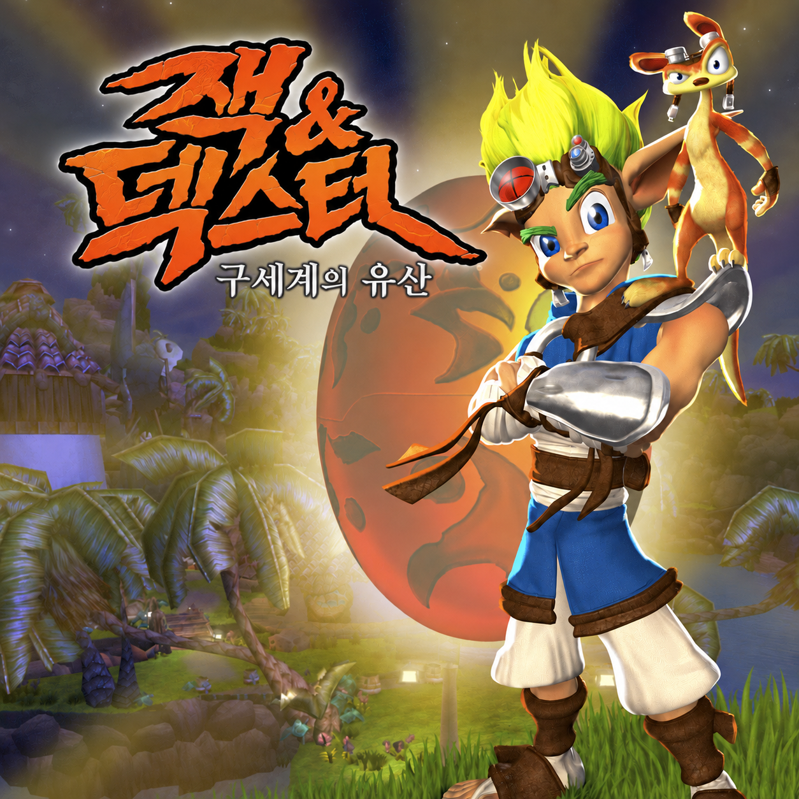

# 잭 & 덱스터: 구세계의 유산 — 한글화 (OpenGOAL)

PS2 『Jak and Daxter: The Precursor Legacy』(잭 1편)를 PC 포트 [OpenGOAL](https://github.com/open-goal/jak-project)에서 한국어로 즐기기 위한 비공식 팬 한글화 프로젝트입니다.



> 번역 전체(2,158항목) 완료·검수 승인. 현황은 [docs/translation_status.md](docs/translation_status.md)를 보세요.

## 무엇을 하나

- **한글 표시**: 1편 폰트에는 한글이 없어서, 폰트 텍스처를 확장하고 새 코드페이지(리드 바이트 2·4–9·11·12·14·15 + 글리프 바이트)를 엔진에 추가했습니다. 최대 2,035 음절.
- **서체**: 메뉴는 배민 주아체, 자막은 Pretendard SemiBold (둘 다 OFL).
- **번역 범위**: 메뉴·힌트 텍스트, OpenGOAL 추가 메뉴, 컷신·힌트 자막, 엔딩 크레딧 제목·역할명 (총 2,158 항목). 음성은 영어 원본 그대로.
- **번역하지 않은 것**: 텍스처로 그려진 글자(타이틀 로고, 진행 메뉴의 "AUTO SAVE OFF" 등), 크레딧의 인명·회사명.
- **언어**: OpenGOAL 의 예약 언어 ID 17(korean)로 텍스트·자막 언어에 추가.

## 설치 (릴리스 파일로 — 일반 사용자)

저장소를 받거나 빌드할 필요가 없습니다. [최신 릴리스](https://github.com/stPark-dev/Jak_Daxter_The_Precursor_Legacy_Korean/releases/latest)의 파일 하나와 본인 ISO 만 있으면 됩니다.
릴리스 파일에는 게임 데이터가 없고, 설치할 때 본인 ISO 에서 게임 데이터를 추출해 한글 패치를 적용합니다.

### 준비물

- 본인 소유의 **Jak and Daxter: The Precursor Legacy 북미판(NTSC-U, SCUS-97124, Black Label) ISO**
  - 확인한 이미지: `Jak and Daxter - The Precursor Legacy (USA) (EnFrDeEsIt)`, 1,460,535,296바이트,
    MD5 `87bab4d563a73c3d61a12394f6997779`, SHA-1 `0db5976cdf9ea188bd64d8efdb4de095c38ea65f`
  - 해시 확인: Windows 는 `certutil -hashfile jak1.iso MD5`, Linux 는 `md5sum jak1.iso`
  - `.zip`/`.7z` 로 압축돼 있으면 먼저 풀어서 `.iso` 파일로 만드세요.
  - 다른 판(Greatest Hits, PAL, 일본판)은 확인하지 않았습니다. 설치 프로그램이 판을 확인해서 맞지 않으면 멈춥니다.
- Windows 64비트 (Windows 10 에서 확인, Visual C++ 런타임은 패키지에 들어 있음) 또는 Linux x86-64 (실행 미검증)
- 디스크 여유 공간 약 4GB (설치 후 추출한 게임 데이터와 빌드 결과가 패키지 폴더에 생깁니다)

### Windows

1. [최신 릴리스](https://github.com/stPark-dev/Jak_Daxter_The_Precursor_Legacy_Korean/releases/latest)에서 `jak1-korean-<버전>-windows.zip` 을 받습니다.
2. 압축을 원하는 폴더에 **전부 풉니다** (zip 안에서 바로 실행하지 마세요). `jak1-korean-<버전>-windows` 폴더가 생깁니다.
3. ISO 파일을 그 폴더의 `install.bat` 위로 **끌어다 놓습니다**.
   또는 `install.bat` 을 실행하고, ISO 파일을 창에 끌어다 놓은 뒤 Enter 를 누릅니다.
   게임 데이터 추출과 한글 패치 빌드에 몇 분 걸리고, "설치가 끝났습니다" 가 나오면 완료입니다.
4. `play.bat` 으로 게임을 실행합니다. 다음부터는 `play.bat` 만 실행하면 됩니다.
5. 게임에서 START → 옵션 → 게임 옵션으로 가서 **텍스트 언어**와 **자막 언어**를 **한국어**로 바꿉니다.
   "음성 언어"는 영어 그대로 두세요 (음성은 영어만 있습니다).

### Linux (실행 미검증)

```bash
tar xzf jak1-korean-<버전>-linux.tar.gz
cd jak1-korean-<버전>-linux
./install.sh /경로/jak1.iso
./play.sh
```

게임 안의 언어 설정은 Windows 와 같습니다.

### 세이브·업데이트·삭제

- 설정과 세이브는 패키지 폴더 안의 `OpenGOAL` 폴더에 저장됩니다. 다른 OpenGOAL 설치와 섞이지 않습니다.
- 새 버전이 나오면 새 패키지를 다른 폴더에 풀어 다시 설치하세요. 이전 폴더의 `OpenGOAL` 폴더를 새 폴더에 복사하면 세이브와 설정을 이어서 쓸 수 있습니다.
- 지우려면 패키지 폴더를 통째로 지우면 됩니다.

### 문제 해결

- **"Windows의 PC 보호" 창이 뜰 때**: 서명하지 않은 프로그램이라 뜰 수 있습니다. "추가 정보" → "실행" 을 누르세요.
- **설치가 실패할 때**: 패키지 폴더의 `data\log` 에 있는 extractor 로그를 확인하세요. ISO 가 북미판 초판이 아니거나 압축된 상태면 실패합니다.
- **한글이 안 보일 때**: 게임 옵션에서 텍스트 언어·자막 언어를 한국어로 바꿨는지 확인하세요.
- 문제가 계속되면 로그를 첨부해 [이슈](https://github.com/stPark-dev/Jak_Daxter_The_Precursor_Legacy_Korean/issues)로 알려 주세요.

## 직접 빌드하기 (개발자)

저장소를 받아 OpenGOAL 을 직접 빌드하는 방법입니다. 번역이나 엔진 패치를 고칠 때 씁니다.

### 필요한 것

- 위와 같은 ISO
- Linux: clang, cmake, ninja, nasm, python3 (+ Pillow, pytest), `libssl-dev` 등 [OpenGOAL 빌드 요구 사항](https://github.com/open-goal/jak-project#building-and-running-the-game)
- Windows: 아래 [Windows 에서 빌드](#windows-에서-빌드) 참고

### Linux 에서 빌드

1. 이 저장소를 받습니다.
   ```bash
   git clone https://github.com/stPark-dev/Jak_Daxter_The_Precursor_Legacy_Korean.git
   cd Jak_Daxter_The_Precursor_Legacy_Korean
   ```
2. OpenGOAL 을 받아 한글 패치를 적용하고 빌드한 뒤, 본인 ISO 를 추출합니다 (처음 한 번, 수십 분 걸림).
   ```bash
   tools/setup_opengoal.sh /path/to/jak1.iso
   ```
3. 한글 폰트를 만들고 번역을 넣어 게임을 빌드합니다.
   ```bash
   tools/build_kr.sh release
   ```
   (`dev` 는 작업용으로 미번역 줄을 영어 원문으로 채웁니다. `release` 는 모든 줄이 검수 승인일 때만 성공합니다.)
4. 실행합니다.
   ```bash
   jak-project/build/Release/bin/game/gk -- -boot -fakeiso
   ```
5. 게임에서 START → 옵션 → 게임 옵션으로 가서 **텍스트 언어**와 **자막 언어**를 **한국어**로 바꿉니다.
   "음성 언어"는 영어 그대로 두세요 (음성은 영어만 있습니다).

#### 문제 해결

- `setup_opengoal.sh` 는 OpenGOAL `b6c8430` 에 패치를 적용합니다. 이미 `jak-project/` 에 다른 수정이 있으면 패치가 실패하니 지우고 다시 실행하세요.
- 확인한 ISO 는 NTSC-U Black Label (SCUS-97124) 뿐입니다. 다른 판(Greatest Hits, PAL, 일본판)은 확인하지 않았습니다.

### Windows 에서 빌드

Windows 10 에서 설치부터 한글 표시까지 확인했습니다 (2026-10-16, VS 2022 Build Tools 17.14 + LLVM 23.1.3).

1. PowerShell 에서 빌드 도구를 설치합니다. 관리자 권한(UAC) 창이 뜨면 허용하세요.
   ```powershell
   winget install --id Microsoft.VisualStudio.2022.BuildTools -e --override "--wait --passive --add Microsoft.VisualStudio.Workload.VCTools --includeRecommended"
   winget install --id Git.Git -e
   winget install --id LLVM.LLVM -e
   winget install --id Kitware.CMake -e
   winget install --id Ninja-build.Ninja -e
   winget install --id NASM.NASM -e
   winget install --id Python.Python.3.11 -e
   python -m pip install pillow pytest
   ```
   설치 후에는 새 터미널을 여세요 (PATH 갱신).
2. 저장소를 받습니다.
   ```bat
   git clone https://github.com/stPark-dev/Jak_Daxter_The_Precursor_Legacy_Korean.git
   cd Jak_Daxter_The_Precursor_Legacy_Korean
   ```
3. OpenGOAL 을 받아 한글 패치를 적용하고 빌드한 뒤, 본인 ISO 를 추출합니다 (처음 한 번, 16코어 기준 약 40분).
   ```bat
   tools\kr.bat setup C:\Games\jak1.iso
   ```
4. 한글 폰트를 만들고 번역을 넣어 게임을 빌드합니다.
   ```bat
   tools\kr.bat build release
   ```
5. 실행합니다.
   ```bat
   tools\kr.bat run
   ```
   (직접 실행하려면 `jak-project\out\build\Release\bin\gk.exe -- -boot -fakeiso`)
6. 게임에서 START → 옵션 → 게임 옵션 → **텍스트 언어**·**자막 언어**를 **한국어**로 바꿉니다.

`tools\kr.bat` 는 Visual Studio C++ 환경(`vcvars64`)을 불러오고, winget 이 PATH 에 넣지 않는 LLVM·NASM 경로를 더한 뒤
Git Bash 로 Linux 와 같은 스크립트(`setup_opengoal.sh`, `build_kr.sh`)를 실행합니다.
Git Bash 의 `link` 명령이 MSVC 링커를 가리지 않도록 MSVC 경로를 앞에 둡니다.
이 저장소와 OpenGOAL 은 줄 끝 변환 없이(LF) 받아야 패치가 적용됩니다 (`.gitattributes`, `core.autocrlf=false` 로 처리).

### 배포 패키지 만들기

`build release` 뒤에 실행합니다. 정적 링크 바이너리를 따로 빌드하고(`out/build/Release-static`), `dist/` 에 zip 을 만듭니다.

```bat
tools\kr.bat package 1.0.0
```

(Linux: `tools/package_kr.sh 1.0.0` → `tar.gz`, 미검증.) 패키지에 ISO 에서 나온 파일이 섞이면 실패합니다.

#### 릴리스 (GitHub Actions)

GitHub Actions 에는 ISO 가 없으므로, ISO 없이 쓸 수 있는 release 빌드 결과물(번역 JSON, 한글 폰트 오버레이, 폰트 표)을
`generated/` 에 커밋해 두고 CI 가 그것으로 패키지를 만듭니다.

1. 번역·폰트·도구를 고쳤다면 `tools\kr.bat build release` 를 실행하고 바뀐 `generated/` 를 함께 커밋합니다.
   (`generated/INPUTS_HASH` 가 입력과 맞지 않으면 CI 가 실패합니다.)
2. `v1.0.0` 같은 태그를 푸시하면 `.github/workflows/release.yml` 이 Windows zip 과 Linux tar.gz 를 만들어 릴리스에 올립니다.
   Actions 탭에서 직접 실행하면 릴리스 없이 결과물만 받을 수 있습니다.

## 저장소 구성

| 경로 | 내용 |
|---|---|
| `patches/opengoal-kr.patch` | OpenGOAL `b6c8430` 기준 엔진 수정 (폰트 코드페이지, 한국어 텍스트·자막 컴파일, 언어 17 등록, 텍스처 오버레이, 테스트) |
| `tools/package_kr.sh`, `tools/dist/` | 배포 패키지 생성 스크립트와 패키지에 들어가는 설치·실행 스크립트 |
| `generated/`, `tools/ci_package.sh`, `.github/workflows/release.yml` | CI 패키징용 release 결과물과 릴리스 자동화 |
| `tools/kr_font/` | 한글 폰트 텍스처·코드표 생성기 (한글 글자만 그린 오버레이를 만들고, 추출 때 원본 폰트 위에 합성) |
| `tools/translation/` | 번역 워크스페이스 도구 (검사·내보내기·읽기 속도 점검) |
| `translation/` | 번역 원문·번역문·검수 상태 |
| `docs/` | 결정 기록, 조사, PoC, 용어집, 진행 현황 |
| `fonts/` | 배민 주아체, Pretendard SemiBold 와 각 OFL 라이선스 |

## 테스트

```bash
(cd tools && python3 -m pytest -q kr_font text translation)   # 도구 테스트
jak-project/build/Release/bin/goalc-test                      # OpenGOAL 회귀 + 한국어 인코딩 테스트
(cd tools && python3 -m pytest -q test_build_output.py)       # 빌드 결과물 검사 (build_kr.sh 이후)
```

## 라이선스·고지

- 『Jak and Daxter』 및 관련 상표·캐릭터·원문 텍스트의 권리는 Sony Interactive Entertainment / Naughty Dog 에 있습니다. 이 프로젝트는 비공식 팬 작업이며 어떤 회사와도 관련이 없습니다.
- 용어집의 한국어 표기는 이 패치의 자체 결정이며 공식 한국어 명칭이 아닙니다 ([docs/glossary.md](docs/glossary.md)).
- 서체: 배민 주아체(© The Jua Project Authors), Pretendard(© Kil Hyung-jin) — SIL Open Font License 1.1.
- OpenGOAL 은 ISC 라이선스입니다.
